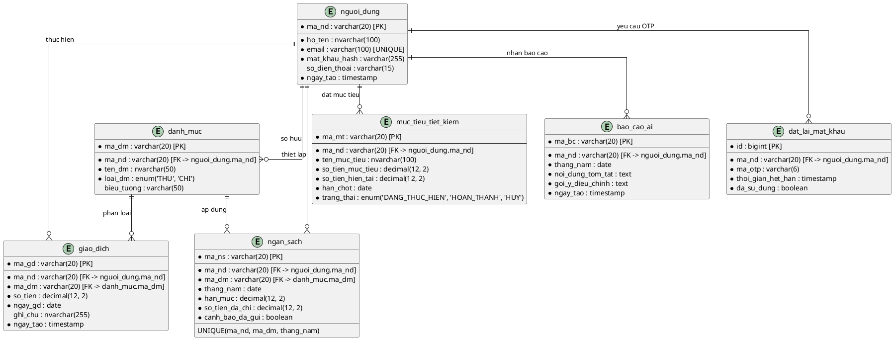
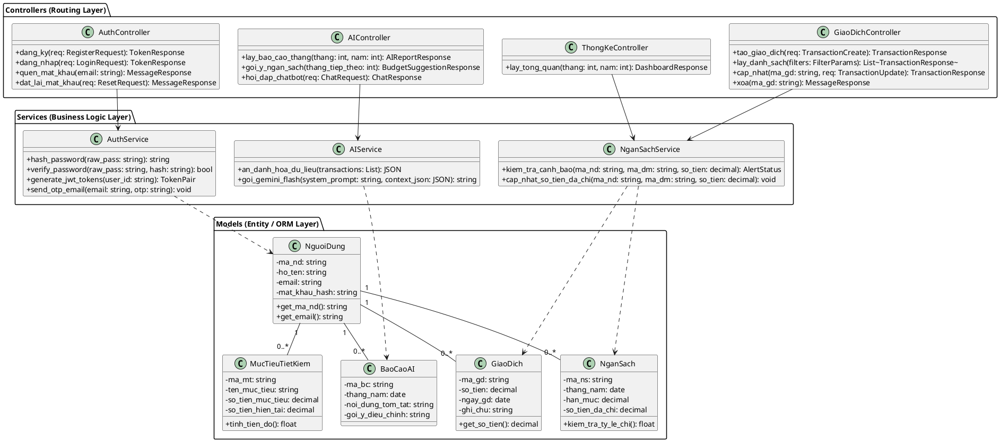

---
name: database-erd-class-diagram
description: Thiết kế Cơ sở Dữ liệu chuẩn hóa 3NF, Sơ đồ ERD Crow Foot Notation và Class Diagram phân tầng cho MoneyMind. Bao gồm Từ điển dữ liệu chi tiết 7 bảng (nguoi_dung, danh_muc, giao_dich, ngan_sach, muc_tieu_tiet_kiem, bao_cao_ai, dat_lai_mat_khau) và mã PlantUML chuẩn mực.
---

# Kỹ Năng: Thiết Kế Cơ Sở Dữ Liệu & Sơ Đồ Lớp (Database ERD & Class Diagram)

> **Chuyên môn**: Database Architect & Design Patterns Specialist
> **Nhiệm vụ**: Thiết kế kiến trúc dữ liệu chuẩn hóa 3NF, sơ đồ ERD và Class Diagram phân tầng cho MoneyMind.

---

## Bộ Nguyên Tắc Bắt Buộc

1. **Danh pháp nhất quán tuyệt đối**: Tên bảng và cột dùng tiếng Việt không dấu, `snake_case`. Tên bảng số ít (VD: `nguoi_dung`, `danh_muc`, `giao_dich`, `ngan_sach`, `muc_tieu_tiet_kiem`, `bao_cao_ai`, `dat_lai_mat_khau`).
2. **Kiểu dữ liệu chính xác**: Tiền tệ bắt buộc là `decimal(12, 2)` (tuyệt đối không viết sai thành `demical`). Khóa chính là `varchar(20)` hoặc `bigint`.
3. **Khóa ngoại tường minh**: Mọi bảng tham chiếu đến `nguoi_dung` phải ghi rõ `ma_nd REFERENCES nguoi_dung(ma_nd)`, cấm viết `nguoi_dung(id)`.
4. **Chuẩn mực Class Diagram**:
   - Thuộc tính phải đóng gói: dấu `-` (Private). Phương thức là `+` (Public).
   - Không đưa thuộc tính khóa ngoại dạng cột CSDL vào Class; quan hệ biểu diễn bằng đường Association.
   - Phân biệt Entity Class (chỉ chứa dữ liệu bản ghi) với Service Class (chứa logic mã hóa, gọi AI, tính toán).

---

## 1. Mã PlantUML Sơ Đồ ERD (Crow's Foot Notation)

---

## 2. Từ Điển Dữ Liệu Chi Tiết (Data Dictionary)

### Bảng `nguoi_dung`

| STT | Tên thuộc tính | Kiểu dữ liệu | Ràng buộc | Mặc định | Diễn giải |
| :--- | :--- | :--- | :--- | :--- | :--- |
| 1 | `ma_nd` | `varchar(20)` | PRIMARY KEY | Không | Mã định danh người dùng (UUID hoặc chuỗi) |
| 2 | `ho_ten` | `nvarchar(100)` | NOT NULL | Không | Họ và tên người dùng |
| 3 | `email` | `varchar(100)` | UNIQUE, NOT NULL | Không | Email đăng nhập hệ thống |
| 4 | `mat_khau_hash` | `varchar(255)` | NOT NULL | Không | Mật khẩu đã băm bằng Bcrypt (Salt >= 12) |
| 5 | `so_dien_thoai` | `varchar(15)` | NULL | NULL | Số điện thoại liên hệ |
| 6 | `ngay_tao` | `timestamp` | NOT NULL | `CURRENT_TIMESTAMP` | Thời điểm tạo tài khoản |

### Bảng `danh_muc`

| STT | Tên thuộc tính | Kiểu dữ liệu | Ràng buộc | Mặc định | Diễn giải |
| :--- | :--- | :--- | :--- | :--- | :--- |
| 1 | `ma_dm` | `varchar(20)` | PRIMARY KEY | Không | Mã định danh danh mục |
| 2 | `ma_nd` | `varchar(20)` | FK -> `nguoi_dung(ma_nd)`, NOT NULL | Không | Người dùng sở hữu danh mục |
| 3 | `ten_dm` | `nvarchar(50)` | NOT NULL | Không | Tên hiển thị danh mục (VD: Ăn uống, Tiền nhà) |
| 4 | `loai_dm` | `enum('THU', 'CHI')` | NOT NULL | Không | Loại danh mục: Thu nhập hoặc Chi tiêu |
| 5 | `bieu_tuong` | `varchar(50)` | NULL | NULL | Emoji biểu tượng danh mục |

### Bảng `giao_dich`

| STT | Tên thuộc tính | Kiểu dữ liệu | Ràng buộc | Mặc định | Diễn giải |
| :--- | :--- | :--- | :--- | :--- | :--- |
| 1 | `ma_gd` | `varchar(20)` | PRIMARY KEY | Không | Mã định danh giao dịch |
| 2 | `ma_nd` | `varchar(20)` | FK -> `nguoi_dung(ma_nd)`, NOT NULL | Không | Người dùng phát sinh giao dịch |
| 3 | `ma_dm` | `varchar(20)` | FK -> `danh_muc(ma_dm)`, NOT NULL | Không | Danh mục phân loại giao dịch |
| 4 | `so_tien` | `decimal(12, 2)` | NOT NULL, > 0 | Không | Giá trị giao dịch (VND) |
| 5 | `ngay_gd` | `date` | NOT NULL | `CURRENT_DATE` | Ngày phát sinh thu/chi |
| 6 | `ghi_chu` | `nvarchar(255)` | NULL | NULL | Nội dung chi tiết giao dịch |
| 7 | `ngay_tao` | `timestamp` | NOT NULL | `CURRENT_TIMESTAMP` | Thời điểm ghi nhận vào hệ thống |

### Bảng `ngan_sach`

| STT | Tên thuộc tính | Kiểu dữ liệu | Ràng buộc | Mặc định | Diễn giải |
| :--- | :--- | :--- | :--- | :--- | :--- |
| 1 | `ma_ns` | `varchar(20)` | PRIMARY KEY | Không | Mã định danh hạn mức ngân sách |
| 2 | `ma_nd` | `varchar(20)` | FK -> `nguoi_dung(ma_nd)` | Không | Mã người dùng sở hữu |
| 3 | `ma_dm` | `varchar(20)` | FK -> `danh_muc(ma_dm)` | Không | Mã danh mục áp dụng ngân sách |
| 4 | `thang_nam` | `date` | NOT NULL | Không | Tháng và năm áp dụng (YYYY-MM-01) |
| 5 | `han_muc` | `decimal(12, 2)` | NOT NULL | Không | Số tiền hạn mức chi tiêu tối đa (VND) |
| 6 | `so_tien_da_chi` | `decimal(12, 2)` | NOT NULL | `0.00` | Tổng số tiền đã chi lũy kế trong tháng |
| 7 | `canh_bao_da_gui` | `boolean` | NOT NULL | `false` | Đã kích hoạt cảnh báo vượt ngưỡng chưa |

*Ràng buộc toàn vẹn*: `UNIQUE(ma_nd, ma_dm, thang_nam)` đảm bảo mỗi danh mục chỉ có 1 hạn mức/tháng.

### Bảng `muc_tieu_tiet_kiem`

| STT | Tên thuộc tính | Kiểu dữ liệu | Ràng buộc | Mặc định | Diễn giải |
| :--- | :--- | :--- | :--- | :--- | :--- |
| 1 | `ma_mt` | `varchar(20)` | PRIMARY KEY | Không | Mã định danh mục tiêu |
| 2 | `ma_nd` | `varchar(20)` | FK -> `nguoi_dung(ma_nd)`, NOT NULL | Không | Người dùng đặt mục tiêu |
| 3 | `ten_muc_tieu` | `nvarchar(100)` | NOT NULL | Không | Tên mục tiêu (VD: Mua xe, Du lịch Nhật) |
| 4 | `so_tien_muc_tieu` | `decimal(12, 2)` | NOT NULL | Không | Số tiền cần đạt được |
| 5 | `so_tien_hien_tai` | `decimal(12, 2)` | NOT NULL | `0.00` | Số tiền đã tích lũy đến hiện tại |
| 6 | `han_chot` | `date` | NOT NULL | Không | Ngày dự kiến hoàn thành mục tiêu |
| 7 | `trang_thai` | `enum('DANG_THUC_HIEN', 'HOAN_THANH', 'HUY')` | NOT NULL | `DANG_THUC_HIEN` | Trạng thái tiến độ mục tiêu |

### Bảng `bao_cao_ai`

| STT | Tên thuộc tính | Kiểu dữ liệu | Ràng buộc | Mặc định | Diễn giải |
| :--- | :--- | :--- | :--- | :--- | :--- |
| 1 | `ma_bc` | `varchar(20)` | PRIMARY KEY | Không | Mã định danh báo cáo |
| 2 | `ma_nd` | `varchar(20)` | FK -> `nguoi_dung(ma_nd)`, NOT NULL | Không | Người dùng sở hữu báo cáo |
| 3 | `thang_nam` | `date` | NOT NULL | Không | Tháng/năm của báo cáo (YYYY-MM-01) |
| 4 | `noi_dung_tom_tat` | `text` | NOT NULL | Không | Đoạn tóm tắt xu hướng chi tiêu từ AI |
| 5 | `goi_y_dieu_chinh` | `text` | NOT NULL | Không | 3 lời khuyên hành động cụ thể từ AI |
| 6 | `ngay_tao` | `timestamp` | NOT NULL | `CURRENT_TIMESTAMP` | Thời điểm tạo báo cáo |

### Bảng `dat_lai_mat_khau`

| STT | Tên thuộc tính | Kiểu dữ liệu | Ràng buộc | Mặc định | Diễn giải |
| :--- | :--- | :--- | :--- | :--- | :--- |
| 1 | `id` | `bigint` | PRIMARY KEY, AUTO_INCREMENT | Không | Mã định danh bản ghi OTP |
| 2 | `ma_nd` | `varchar(20)` | FK -> `nguoi_dung(ma_nd)`, NOT NULL | Không | Người dùng yêu cầu đặt lại mật khẩu |
| 3 | `ma_otp` | `varchar(6)` | NOT NULL | Không | Mã OTP 6 chữ số ngẫu nhiên |
| 4 | `thoi_gian_het_han` | `timestamp` | NOT NULL | Không | Thời điểm OTP hết hiệu lực (5 phút kể từ tạo) |
| 5 | `da_su_dung` | `boolean` | NOT NULL | `false` | Đã sử dụng để đặt lại mật khẩu chưa |

---

## 3. Mã PlantUML Sơ Đồ Lớp Chi Tiết (Design Class Diagram)

