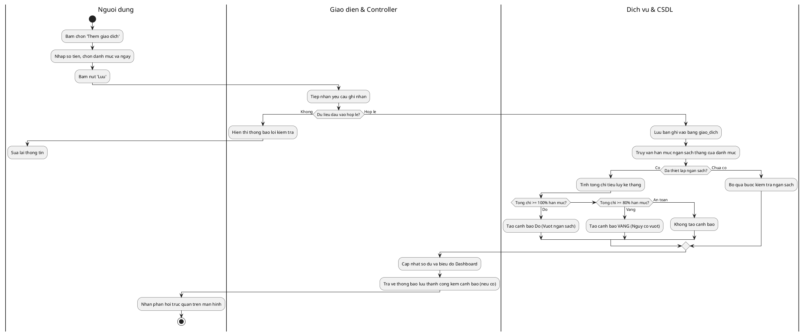
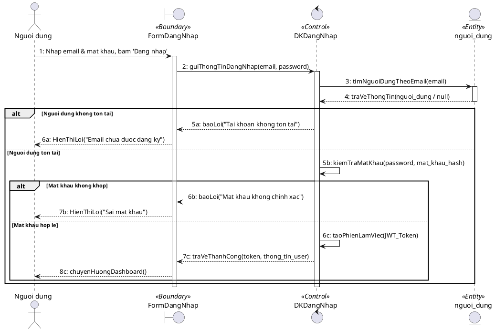
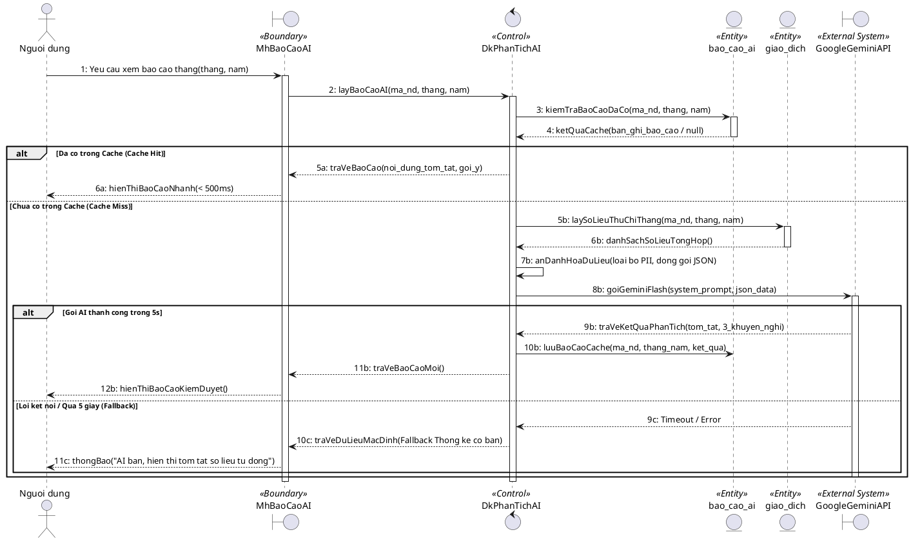
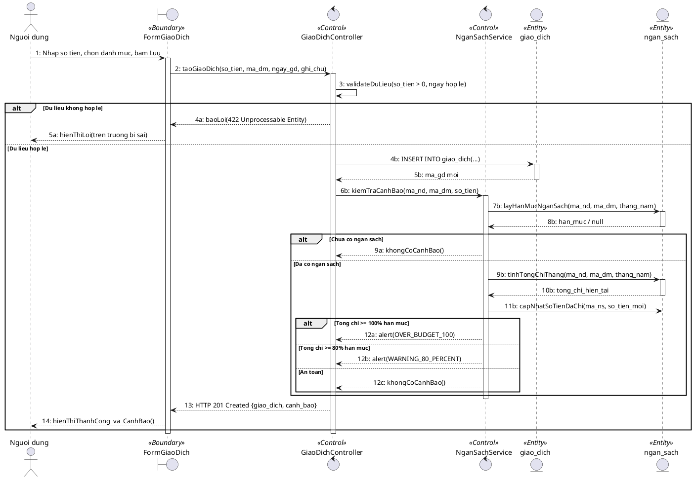

---
name: dynamic-activity-sequence-bce
description: Mô hình hóa Động - Activity Diagram có Swimlanes và Sequence Diagram chuẩn phân tích BCE (Boundary-Control-Entity) bằng PlantUML cho MoneyMind. Bao gồm luồng Ghi nhận giao dịch kết hợp Cảnh báo ngân sách (UC004+UC007) và luồng Báo cáo AI tháng có Cache và Fallback (UC010).
---

# Kỹ Năng: Mô Hình Hóa Động - Activity Swimlanes & Sequence BCE

> **Chuyên môn**: Software Interaction Designer & UML Dynamic Modeler
> **Nhiệm vụ**: Xây dựng Sơ đồ Hoạt động (Activity Diagram) có phân làn và Sơ đồ Trình tự (Sequence Diagram) theo chuẩn phân tích BCE cho các luồng nghiệp vụ trọng yếu.

---

## Bộ Nguyên Tắc Bắt Buộc

1. **Sơ đồ Hoạt động BẮT BUỘC dùng Swimlanes (Phân làn)** tối thiểu 3 làn: `[Người dùng]` | `[Giao diện & Controller]` | `[Dịch vụ & CSDL / AI]`.
2. **Sơ đồ Trình tự BẮT BUỘC phân loại đối tượng theo chuẩn BCE**:
   - **Boundary**: Form / Màn hình / Giao diện người dùng.
   - **Control**: Controller điều phối / Service xử lý logic.
   - **Entity**: Bảng dữ liệu / Mô hình CSDL lưu trữ.
   - **External System**: Google Gemini API (khi có tác vụ AI).
3. **Logic xác thực và xử lý CSDL**: Control phải gọi truy vấn Entity trước khi so khớp thông tin. Phải có khối `alt / else` biểu diễn đầy đủ trường hợp Hợp lệ và Bất hợp lệ (Trùng lặp, Sai mật khẩu, Vượt ngân sách, Timeout AI).

---

## 1. Sơ Đồ Hoạt Động Có Phân Làn (Activity Swimlanes)

### Luồng Ghi nhận giao dịch & Kích hoạt cảnh báo ngân sách (UC004 + UC007)

---

## 2. Bộ Sơ Đồ Trình Tự Chuẩn Phân Tích BCE (PlantUML)

### UC001: Biểu đồ trình tự Đăng nhập tài khoản

---

### UC010: Biểu đồ trình tự Xem báo cáo AI tháng (kèm Caching & Gemini API)

---

### UC004: Biểu đồ trình tự Ghi nhận giao dịch & Cảnh báo ngân sách

