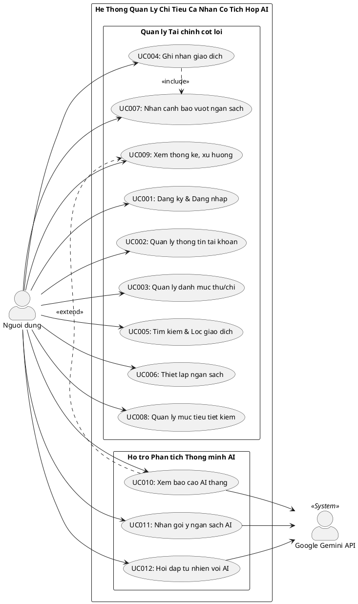

---
name: uml-use-case-modeling
description: Mô hình hóa Chức năng và Phân ra Use Case UML 2.5 cho MoneyMind. Bao gồm bảng danh mục 12 Use Case (UC001-UC012), mã PlantUML sơ đồ Use Case tổng quát và phân ra, đặc tả Use Case chi tiết theo mẫu chuẩn 8 mục.
---

# Kỹ Năng: Mô Hình Hóa Use Case UML 2.5

> **Chuyên môn**: Senior Systems Analyst & UML 2.5 Specialist
> **Nhiệm vụ**: Mô hình hóa chức năng và xây dựng đặc tả Use Case chi tiết cho 12 Use Case (UC001 đến UC012) của hệ thống MoneyMind.

---

## Bộ Nguyên Tắc Bắt Buộc

1. **Quy ước mũi tên quan hệ UML 2.5**:
   - `<<extend>>`: Mũi tên nét đứt PHẢI trỏ từ Use Case mở rộng về Use Case cơ sở (Extending UC -> Base UC).
   - `<<include>>`: Mũi tên nét đứt trỏ từ Use Case gọi sang Use Case thành phần bắt buộc (Base UC -> Included UC).
2. **KHÔNG ĐƯỢC lạm dụng `<<include>> Đăng nhập`**: Đăng nhập là Tiền điều kiện (Pre-condition), không được nối mũi tên include từ các Use Case nghiệp vụ vào Đăng nhập.
3. **UC012 (Chatbot hỏi đáp tự nhiên) BẮT BUỘC phải xuất hiện đầy đủ** trên sơ đồ tổng quát và phân ra.

---

## 1. Bảng Danh Mục Actor & Use Case

### Bảng Tác nhân:

| Tác nhân | Phân loại | Vai trò & Trách nhiệm |
| :--- | :--- | :--- |
| **Người dùng** | Primary Actor | Người dùng cá nhân sử dụng hệ thống để quản lý thu chi, ngân sách và tương tác với AI. |
| **Google Gemini API** | Secondary Actor | Hệ thống trí tuệ nhân tạo bên ngoài, tiếp nhận dữ liệu số liệu ẩn danh và trả về kết quả phân tích. |

### Bảng Use Case:

| Mã UC | Tên Use Case | Tác nhân chính | Tác nhân phụ | Quan hệ chính |
| :--- | :--- | :--- | :--- | :--- |
| **UC001** | Đăng ký & Đăng nhập | Người dùng | - | Quản lý phiên làm việc |
| **UC002** | Quản lý thông tin tài khoản | Người dùng | - | Cập nhật hồ sơ, đổi mật khẩu |
| **UC003** | Quản lý danh mục thu/chi | Người dùng | - | CRUD danh mục |
| **UC004** | Ghi nhận giao dịch | Người dùng | - | `<<include>>` UC007 |
| **UC005** | Tìm kiếm & Lọc giao dịch | Người dùng | - | Tra cứu đa tiêu chí |
| **UC006** | Thiết lập ngân sách | Người dùng | - | Đặt hạn mức chi tiêu tháng |
| **UC007** | Nhận cảnh báo vượt ngân sách | Người dùng | - | Được gọi tự động từ UC004 |
| **UC008** | Quản lý mục tiêu tiết kiệm | Người dùng | - | CRUD & nạp tiền tích lũy |
| **UC009** | Xem thống kê, xu hướng chi tiêu | Người dùng | - | `<<extend>>` UC010 |
| **UC010** | Xem báo cáo AI tháng | Người dùng | Google Gemini API | Phân tích & sinh khuyến nghị |
| **UC011** | Nhận gợi ý ngân sách AI | Người dùng | Google Gemini API | Đề xuất phân bổ tài chính |
| **UC012** | Hỏi đáp tự nhiên với AI (Chatbot) | Người dùng | Google Gemini API | Tương tác hội thoại thông minh |

---

## 2. Mã PlantUML Sơ Đồ Use Case Tổng Quát

---

## 3. Đặc Tả Chi Tiết Use Case (Mẫu Chuẩn 8 Mục)

### Đặc tả UC004: Ghi nhận giao dịch (kèm include UC007)

- **Mã & Tên Use Case**: UC004 - Ghi nhận giao dịch.
- **Tác nhân**: Người dùng (Khởi tạo).
- **Mục tiêu**: Cho phép người dùng lưu lại khoản chi tiêu hoặc thu nhập mới phát sinh trong thời gian < 5 giây.
- **Tiền điều kiện (Pre-conditions)**: Người dùng đã đăng nhập; đã có ít nhất một danh mục trong hệ thống.
- **Hậu điều kiện (Post-conditions)**: Giao dịch được lưu vào CSDL; số dư và ngân sách liên quan được cập nhật; cảnh báo được kích hoạt nếu vượt ngưỡng.
- **Luồng sự kiện chính (Basic Flow)**:
  1. Người dùng bấm nút "Thêm giao dịch" trên thanh công cụ hoặc Dashboard.
  2. Hệ thống hiển thị form nhập tối giản gồm: Số tiền, Loại (Thu/Chi), Danh mục, Ngày giao dịch, Ghi chú.
  3. Người dùng nhập số tiền, bấm chọn nhanh danh mục và xác nhận.
  4. Hệ thống kiểm tra dữ liệu hợp lệ (Số tiền > 0, ngày hợp lệ).
  5. Hệ thống lưu bản ghi vào bảng `giao_dich`.
  6. **Bao gồm bắt buộc (`<<include>>` UC007)**: Hệ thống tính toán tổng chi tiêu của danh mục trong tháng hiện tại và so sánh với hạn mức tại bảng `ngan_sach`. Nếu đạt >= 80%, hệ thống đính kèm dữ liệu cảnh báo vào phản hồi.
  7. Hệ thống cập nhật số dư trên Dashboard và trả về thông báo thành công kèm cảnh báo (nếu có).
- **Luồng thay thế / Ngoại lệ**:
  - *A1 - Dữ liệu không hợp lệ*: Người dùng nhập số tiền <= 0 hoặc để trống trường bắt buộc -> Hệ thống báo lỗi đỏ tại trường đó, không lưu CSDL.
  - *A2 - Danh mục chưa có ngân sách*: Bước 6 kiểm tra danh mục chưa được thiết lập ngân sách -> Bỏ qua bước so sánh cảnh báo, hoàn tất lưu giao dịch bình thường.
- **Quy tắc nghiệp vụ liên quan**: BR-01 (Loại danh mục khớp loại giao dịch), BR-05 (Ngưỡng cảnh báo ngân sách), BR-06 (Phân quyền người dùng).

---

### Đặc tả UC001: Đăng ký & Đăng nhập

- **Mã & Tên Use Case**: UC001 - Đăng ký & Đăng nhập.
- **Tác nhân**: Người dùng (Khởi tạo).
- **Mục tiêu**: Cho phép người dùng mới đăng ký tài khoản và người dùng hiện tại đăng nhập an toàn vào hệ thống.
- **Tiền điều kiện**: Người dùng có kết nối mạng.
- **Hậu điều kiện**: Người dùng nhận được cặp JWT (Access Token + Refresh Token) hợp lệ và được chuyển hướng về Dashboard.
- **Luồng sự kiện chính (Đăng nhập)**:
  1. Người dùng nhập email và mật khẩu, bấm "Đăng nhập".
  2. Hệ thống kiểm tra email tồn tại trong CSDL.
  3. Hệ thống xác minh mật khẩu với hash Bcrypt lưu trong CSDL.
  4. Hệ thống tạo cặp JWT Token (Access 60 phút, Refresh 7 ngày).
  5. Hệ thống trả về token và chuyển hướng về Dashboard.
- **Luồng thay thế / Ngoại lệ**:
  - *A1 - Email không tồn tại*: HTTP 401 Unauthorized; thông báo lỗi bảo mật chung (không tiết lộ email có tồn tại hay không).
  - *A2 - Mật khẩu sai*: HTTP 401 Unauthorized; thông báo lỗi bảo mật chung.
- **Quy tắc nghiệp vụ liên quan**: BR-02 (Bảo mật mật khẩu & phiên đăng nhập).

---

### Đặc tả UC010: Xem báo cáo AI tháng

- **Mã & Tên Use Case**: UC010 - Xem báo cáo AI tháng.
- **Tác nhân**: Người dùng (Khởi tạo), Google Gemini API (Tham gia).
- **Mục tiêu**: Người dùng nhận được báo cáo phân tích tài chính tháng bằng ngôn ngữ tự nhiên với 3 lời khuyên hành động cụ thể.
- **Tiền điều kiện**: Người dùng đã đăng nhập; đã có ít nhất 1 giao dịch trong tháng yêu cầu.
- **Hậu điều kiện**: Báo cáo được hiển thị và lưu vào cache bảng `bao_cao_ai` để tái sử dụng.
- **Luồng sự kiện chính**:
  1. Người dùng bấm "Xem Báo cáo AI Tháng" trên Dashboard.
  2. Hệ thống kiểm tra bảng `bao_cao_ai` xem đã có báo cáo tháng này chưa.
  3. **[Cache Hit]**: Nếu đã có -> Trả về báo cáo ngay (< 500ms).
  4. **[Cache Miss]**: Nếu chưa có -> Truy vấn tổng hợp dữ liệu giao dịch tháng từ CSDL.
  5. Hệ thống áp dụng thuật toán PII Sanitization: loại bỏ hoàn toàn thông tin định danh, chỉ giữ lại tên danh mục và số liệu.
  6. Hệ thống gọi Google Gemini Flash với system prompt chuẩn hóa.
  7. Nhận kết quả, lưu vào bảng `bao_cao_ai` (Cache).
  8. Hiển thị báo cáo kèm Privacy Badge xác nhận dữ liệu đã được ẩn danh hóa.
- **Luồng thay thế / Ngoại lệ**:
  - *A1 - AI Timeout > 5s*: Kích hoạt Fallback; trả về thống kê cơ bản từ CSDL kèm thông báo "Trợ lý AI đang bận, dưới đây là thống kê tự động từ hệ thống."
  - *A2 - Lỗi HTTP 429/503*: Tương tự A1; không để màn hình bị treo.
- **Quy tắc nghiệp vụ liên quan**: BR-03 (Ẩn danh hóa PII), BR-04 (Caching báo cáo AI), BR-06 (Phân quyền).

---

### Đặc tả UC012: Hỏi đáp tự nhiên với AI (Chatbot)

- **Mã & Tên Use Case**: UC012 - Hỏi đáp tự nhiên với AI (Chatbot).
- **Tác nhân**: Người dùng (Khởi tạo), Google Gemini API (Tham gia).
- **Mục tiêu**: Người dùng có thể đặt câu hỏi tự nhiên về dữ liệu tài chính và nhận câu trả lời thông minh, cụ thể.
- **Tiền điều kiện**: Người dùng đã đăng nhập.
- **Hậu điều kiện**: Câu trả lời được hiển thị trong khung chat; không có dữ liệu PII nào được gửi đến Gemini API.
- **Luồng sự kiện chính**:
  1. Người dùng nhập câu hỏi vào ô chat (VD: "Tháng này tôi tiêu gì nhiều nhất?").
  2. Hệ thống truy vấn và tổng hợp dữ liệu giao dịch liên quan của người dùng.
  3. Hệ thống ẩn danh hóa dữ liệu (loại bỏ PII), đóng gói thành JSON số liệu.
  4. Hệ thống gọi Gemini API với rate limiting (tối đa 10 câu hỏi/phút/người dùng).
  5. Nhận kết quả và hiển thị trong khung chat kèm gợi ý câu hỏi tiếp theo.
- **Luồng thay thế / Ngoại lệ**:
  - *A1 - Câu hỏi ngoài phạm vi tài chính*: AI từ chối và thông báo "Tôi chỉ hỗ trợ các câu hỏi về tài chính cá nhân."
  - *A2 - Vượt Rate Limit*: HTTP 429; thông báo "Bạn đã đặt quá nhiều câu hỏi, vui lòng thử lại sau 1 phút."
- **Quy tắc nghiệp vụ liên quan**: BR-03 (Ẩn danh hóa PII), BR-06 (Phân quyền).
