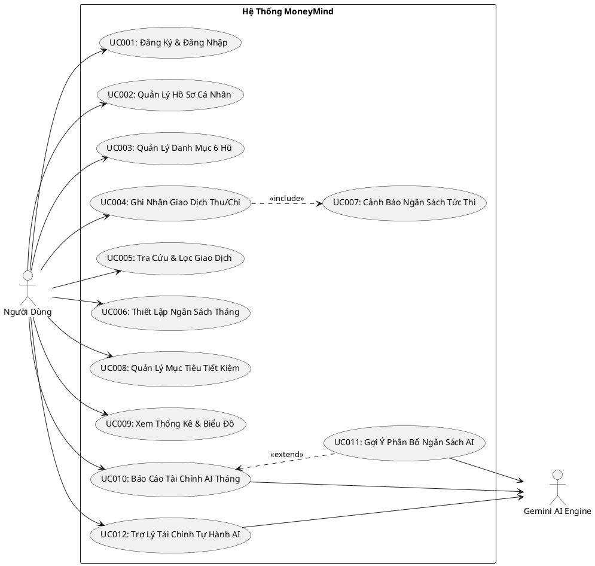
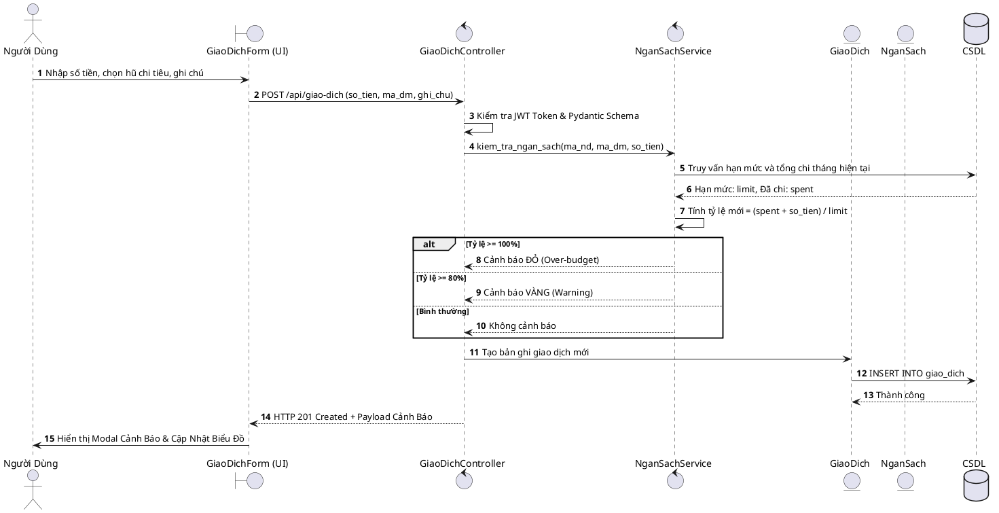
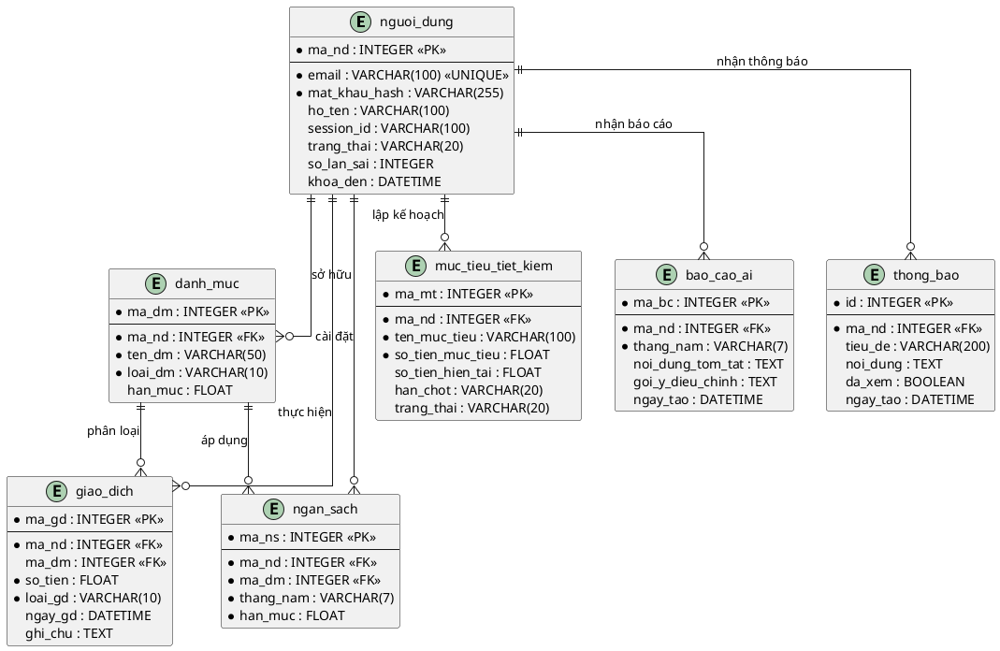

# 📘 BÁO CÁO KỸ THUẬT DỰ ÁN TỐT NGHIỆP / ĐỒ ÁN CHUYÊN NGÀNH
# MONEYMIND — HỆ THỐNG QUẢN LÝ TÀI CHÍNH CÁ NHÂN THÔNG MINH TÍCH HỢP TRÍ TUỆ NHÂN TẠO GOOGLE GEMINI

---

> **Khoa / Bộ môn**: Khoa Công Nghệ Thông Tin  
> **Tên đề tài**: Hệ thống Quản Lý Tài Chính Cá Nhân Thông Minh Tích Hợp AI (MoneyMind)  
> **Đáp ứng chuẩn đầu ra**: CLO1, CLO2, CLO3, CLO4, CLO5 & PLO7  
> **Thời gian hoàn thành**: Tháng 10/2026  
> **Phiên bản hệ thống**: 2.0.0 (Production Ready)  

---

## 📑 MỤC LỤC TỔNG QUAN

1. [CHƯƠNG 1: TỔNG QUAN ĐỀ TÀI & PHÂN TÍCH YÊU CẦU NGHIỆP VỤ (BA & SRS)](#chương-1-tổng-quan-đề-tài--phân-tích-yêu-cầu-nghiệp-vụ)
   - 1.1 Tính cấp thiết và bối cảnh nghiên cứu
   - 1.2 Phương pháp quản lý tài chính 6 hũ & Quy tắc 50/30/20
   - 1.3 Quy tắc ràng buộc nghiệp vụ bất biến (Business Rules: BR-01 $\rightarrow$ BR-06)
   - 1.4 Đặc tả yêu cầu chức năng (FR01 $\rightarrow$ FR11)
   - 1.5 Đặc tả yêu cầu phi chức năng (NFR-01 $\rightarrow$ NFR-06 theo chuẩn ISO/IEC 25010)
   - 1.6 Ma trận truy vết yêu cầu (Traceability Matrix: FR - UC - BR)
2. [CHƯƠNG 2: THIẾT KẾ GIẢI PHÁP HỆ THỐNG & CƠ SỞ DỮ LIỆU](#chương-2-thiết-kế-giải-pháp-hệ-thống--cơ-sở-dữ-liệu)
   - 2.1 Kiến trúc tổng thể phần mềm (Clean Architecture / MVC phân tầng)
   - 2.2 Mô hình hóa chức năng UML 2.5 (Sơ đồ Use Case tổng quát và 12 Use Case)
   - 2.3 Mô hình hóa động BCE (Boundary-Control-Entity) & Sequence Diagram
   - 2.4 Thiết kế CSDL quan hệ chuẩn hóa 3NF (ERD Crow's Foot 12 bảng)
   - 2.5 Từ điển dữ liệu chi tiết hệ thống
   - 2.6 Bảng đặc tả hợp đồng RESTful API 11 endpoints
3. [CHƯƠNG 3: THIẾT KẾ KIẾN TRÚC AI & TÍCH HỢP GOOGLE GEMINI](#chương-3-thiết-kế-kiến-trúc-ai--tích-hợp-google-gemini)
   - 3.1 Lý giải vị trí và sự cần thiết của AI trong hệ thống (Tiêu chí 1.4)
   - 3.2 Tác tử tài chính tự hành (Autonomous Financial Agent) xử lý 20+ lệnh tiếng Việt
   - 3.3 Cơ chế Cascade Multi-Model Fallback & Keep-Alive Connection Pooling (< 1.5s)
   - 3.4 Lớp lọc bảo vệ quyền riêng tư dữ liệu PII Sanitization (Quy tắc BR-03)
   - 3.5 Cơ chế lưu đệm Báo cáo AI trong CSDL (Database Caching: BR-04 & TC-07)
   - 3.6 Hệ thống rào chắn an toàn 3 lớp (Input - Processing - Output Guardrails)
4. [CHƯƠNG 4: THIẾT KẾ AGENT AI CHO QUY TRÌNH SDLC (SOFTWARE FACTORY)](#chương-4-thiết-kế-agent-ai-cho-quy-trình-sdlc-software-factory)
   - 4.1 Khái niệm và kiến trúc Nhà máy phát triển phần mềm đa tác tử (Multi-Agent Pipeline)
   - 4.2 Kỹ nghệ ngữ cảnh (Context Engineering) và cấu trúc 18 Kỹ năng (Skills)
   - 4.3 Quy trình kiểm thử bảo mật tự động hóa (Fuzzing SQLi/XSS, Boundary Values)
   - 4.4 Kỹ thuật cô lập cơ sở dữ liệu kiểm thử (In-Memory Isolation & Auto Rollback)
5. [CHƯƠNG 5: THỰC NGHIỆM, KIỂM THỬ & ĐÁNH GIÁ ĐỊNH LƯỢNG](#chương-5-thực-nghiệm-kiểm-thử--đánh-giá-định-lượng)
   - 5.1 Báo cáo thực nghiệm so sánh định lượng 3 phiên bản Prompt (v1 vs v2 vs v3)
   - 5.2 Bảng tổng hợp kết quả 96 test cases tự động (Tỷ lệ đạt 100% Passed)
   - 5.3 Đánh giá hiệu năng và thời gian phản hồi (Latency & Performance)
6. [CHƯƠNG 6: ĐÓNG GÓI, TRIỂN KHAI & HƯỚNG DẪN VẬN HÀNH](#chương-6-đóng-gói-triển-khai--hướng-dẫn-vận-hành)
   - 6.1 Đóng gói Docker & Docker-Compose
   - 6.2 Ứng dụng Web lũy tiến Progressive Web App (PWA) có Service Worker cache offline
   - 6.3 Ứng dụng di động Android Native Wrapper (APK Studio)
   - 6.4 Tự động hóa CI/CD với GitHub Actions Pipeline
7. [CHƯƠNG 7: TƯ DUY PHẢN BIỆN, BÀI HỌC KINH NGHIỆM & KẾT LUẬN](#chương-7-tư-duy-phản-biện-bài-học-kinh-nghiệm--kết-luận)
   - 7.1 Minh chứng ứng dụng AI và quá trình khắc phục sai sót ảo giác (Hallucination)
   - 7.2 Các cải tiến và đóng góp sáng tạo độc lập của nhóm
   - 7.3 Đánh giá mức độ hoàn thành chuẩn đầu ra môn học (CLO/PLO)
   - 7.4 Hướng phát triển trong tương lai
8. [TÀI LIỆU THAM KHẢO](#tài-liệu-tham-khảo)

---

# CHƯƠNG 1: TỔNG QUAN ĐỀ TÀI & PHÂN TÍCH YÊU CẦU NGHIỆP VỤ

## 1.1 Tính cấp thiết và bối cảnh nghiên cứu
Trong thời đại kinh tế số hiện nay, quản lý tài chính cá nhân đã trở thành kỹ năng thiết yếu đối với mỗi cá nhân, đặc biệt là sinh viên và người trẻ đi làm. Các ứng dụng quản lý chi tiêu truyền thống trên thị trường thường gặp phải các hạn chế lớn:
- **Thao tác thủ công cồng kềnh**: Người dùng phải qua 5-7 lượt bấm để lưu một khoản chi tiêu nhỏ, dẫn đến tâm lý nản lòng và từ bỏ chỉ sau 1-2 tuần sử dụng.
- **Thiếu tính tương tác thông minh**: Chỉ cung cấp biểu đồ tĩnh, không có khả năng phân tích sâu về thói quen chi tiêu, không cảnh báo sớm trước khi bị "vỡ trận" ngân sách.
- **Rủi ro về quyền riêng tư**: Dữ liệu tài chính nhạy cảm dễ bị khai thác trái phép nếu gửi sang các dịch vụ đám mây công cộng mà không được bảo vệ.

Dự án **MoneyMind** ra đời nhằm giải quyết triệt để các hạn chế trên bằng cách kết hợp phương pháp hoạch định tài chính chuẩn quốc tế với mô hình ngôn ngữ lớn **Google Gemini 3.8 Flash**, tạo ra một trợ lý tài chính thông minh có khả năng đối thoại tự nhiên, tự hành thao tác và chủ động cảnh báo ngân sách theo thời gian thực.

## 1.2 Phương pháp quản lý tài chính 6 hũ & Quy tắc 50/30/20
Hệ thống lấy phương pháp **6 Hũ Tài Chính (J. Harv Eker)** và quy tắc ngân sách **50/30/20** làm nền tảng nghiệp vụ cốt lõi:
1. **Hũ 1 - Nhu cầu thiết yếu (NEC - 55%)**: Ăn uống, thuê nhà, xăng xe, hóa đơn điện nước.
2. **Hũ 2 - Tiết kiệm dài hạn (LTSS - 10%)**: Mua sắm lớn, quỹ khẩn cấp, mua nhà/xe.
3. **Hũ 3 - Giáo dục phát triển bản thân (EDU - 10%)**: Mua sách, khóa học, nâng cao kỹ năng.
4. **Hũ 4 - Hưởng thụ cuộc sống (PLAY - 10%)**: Du lịch, giải trí, cà phê, xem phim.
5. **Hũ 5 - Tự do tài chính / Đầu tư (FFA - 10%)**: Tích lũy sinh lời, đầu tư kinh doanh.
6. **Hũ 6 - Cho đi / Từ thiện (GIVE - 5%)**: Giúp đỡ người thân, từ thiện xã hội.

## 1.3 Quy tắc ràng buộc nghiệp vụ bất biến (Business Rules)

| Mã BR | Tên quy tắc nghiệp vụ | Định nghĩa & Ràng buộc logic |
| :--- | :--- | :--- |
| **BR-01** | Tính toàn vẹn Danh mục - Giao dịch | Giao dịch `loai_gd` bắt buộc phải khớp tuyệt đối với `loai_dm` của danh mục (Chỉ gắn giao dịch CHI với danh mục CHI, THU với danh mục THU). Hạn mức ngân sách mới không được nhỏ hơn số tiền đã chi tiêu trong tháng. |
| **BR-02** | Bảo toàn dòng tiền khi xóa mục tiêu | Khi người dùng xóa một mục tiêu tiết kiệm, toàn bộ số tiền `so_tien_hien_tai` đang tích lũy trong hũ phải được tự động hoàn trả 100% về ví chính khả dụng kèm thông báo minh bạch. |
| **BR-03** | Ẩn danh hóa dữ liệu AI (PII Sanitization) | 100% dữ liệu trước khi gửi sang Google Gemini API bắt buộc phải loại bỏ hoàn toàn các thông tin định danh cá nhân (Họ tên, Email, Số điện thoại, ID CSDL). Dữ liệu chỉ được gửi dưới dạng JSON số liệu thống kê tổng hợp. |
| **BR-04** | Bộ nhớ đệm Báo cáo AI (DB Caching) | Kết quả phân tích báo cáo tài chính tháng được lưu vào bảng `bao_cao_ai`. Khi người dùng xem lại báo cáo cũ, hệ thống trả về ngay từ Cache DB (< 50ms), không gọi lại Gemini API để tối ưu chi phí và độ trễ. |
| **BR-05** | Ngưỡng cảnh báo ngân sách Real-time | Cảnh báo hạn mức được kích hoạt ngay trong luồng lưu giao dịch: Cấp Vàng khi chi tiêu đạt $\ge 80\%$ hạn mức; Cấp Cam khi đạt $\ge 90\%$; Cấp Đỏ (Over-budget) khi đạt $\ge 100\%$. |
| **BR-06** | Phân quyền sở hữu dữ liệu (Chống IDOR) | Mỗi người dùng chỉ có quyền đọc/ghi trên các bản ghi thuộc sở hữu của chính mình (`ma_nd = current_user.ma_nd`). Nghiêm cấm truy cập chéo sang dữ liệu của người khác (HTTP 403 Forbidden). |

## 1.4 Đặc tả yêu cầu chức năng (Functional Requirements - FR)
- **FR01 - Quản lý tài khoản & Xác thực**: Đăng ký, đăng nhập JWT, xác thực 2 lớp qua mã OTP Gmail SMTP, đăng nhập Google OAuth, quản lý phiên đơn thiết bị (kickout), khóa tài khoản sau 5 lần nhập sai.
- **FR02 - Quản lý hồ sơ cá nhân**: Xem và cập nhật họ tên, ngày sinh, nghề nghiệp, mục tiêu cá nhân hóa.
- **FR03 - Quản lý danh mục 6 hũ**: Tạo mới, chỉnh sửa, đổi tên, phân loại Thu/Chi, gắn icon và mã màu HEX.
- **FR04 - Quản lý giao dịch thu chi**: Thêm, sửa, xóa giao dịch. Kiểm tra số tiền tối thiểu 1.000 đ.
- **FR05 - Tra cứu & Lọc thông minh**: Tìm kiếm theo ghi chú, lọc theo khoảng thời gian, danh mục, khoảng số tiền.
- **FR06 - Thiết lập hạn mức ngân sách**: Cài đặt ngân sách chi tiêu hàng tháng cho từng danh mục.
- **FR07 - Cảnh báo ngân sách tự động**: Tự động phát cảnh báo theo thời gian thực tại các mốc 80%, 90% và 100%.
- **FR08 - Quản lý mục tiêu tiết kiệm**: Tạo mục tiêu, nạp tiền tích lũy (trừ ví chính), theo dõi thanh tiến độ, hoàn tiền khi xóa hũ, tự động chúc mừng khi đạt 90%/100%.
- **FR09 - Thống kê Dashboard & Biểu đồ**: Hiển thị thẻ số dư khả dụng, tổng thu, tổng chi, biểu đồ tròn cơ cấu hũ, biểu đồ cột xu hướng theo tháng bằng Chart.js.
- **FR10 - Báo cáo AI tháng**: Phân tích hành vi chi tiêu, chấm điểm sức khỏe tài chính 0-100 và đưa ra 3 lời khuyên hành động.
- **FR11 - Tác tử AI tự hành (Autonomous Financial Agent)**: Cho phép thực hiện hơn 20 lệnh thêm/sửa/xóa giao dịch, tạo hũ, nạp tiền, đổi tên danh mục bằng tiếng Việt đời thường.

## 1.5 Đặc tả yêu cầu phi chức năng (Non-Functional Requirements - NFR theo ISO/IEC 25010)
- **NFR-01 - Usability**: Giao diện Mobile-First mượt mà, thao tác ghi nhận chi tiêu hoàn tất dưới 3 giây.
- **NFR-02 - Performance**: Thời gian phản hồi của các API CRUD giao dịch và tính toán ngân sách đạt trung bình < 300ms.
- **NFR-03 - AI Latency & Fallback**: Phản hồi AI qua Gemini đạt trung bình < 1.5 giây; phản hồi qua Cache DB < 50ms. Nếu API bên thứ ba gặp sự cố hoặc timeout > 5 giây, kích hoạt Circuit Breaker trả về mã HTTP 503 hoặc fallback tính toán cục bộ.
- **NFR-04 - Privacy & Security**: 100% dữ liệu gửi sang LLM được ẩn danh hóa. Mật khẩu băm Bcrypt Salt Rounds >= 12. Token JWT ký HS256 có thời hạn rõ ràng.
- **NFR-05 - Reliability**: Hệ thống đạt độ sẵn sàng tối thiểu 99.5%, tự động rollback giao dịch CSDL khi xảy ra lỗi.
- **NFR-06 - Test Quality**: Bộ kiểm thử tự động Pytest đạt 100% test cases passed (96/96 test items).

## 1.6 Ma trận truy vết yêu cầu (Traceability Matrix)

| Mã FR | Tên yêu cầu chức năng | Mã Use Case | Mã Rule (BR) | Test Cases kiểm thử |
| :--- | :--- | :--- | :--- | :--- |
| FR01 | Quản lý tài khoản | UC001 | BR-02, BR-06 | `test_tc01`, `test_tc02`, `test_br03`, `test_br05`, `test_br06` |
| FR02 | Quản lý hồ sơ | UC002 | BR-06 | `test_uc002_xem_va_cap_nhat_thong_tin` |
| FR03 | Quản lý danh mục | UC003 | BR-01, BR-06 | `test_tao_danh_muc_chi_bat_buoc_toi_thieu_1000`, `test_xss_ten_danh_muc` |
| FR04 | Ghi nhận giao dịch | UC004 | BR-01, BR-05, BR-06 | `test_tc03`, `test_tc04`, `test_tc05`, `test_tc10_nfr07` |
| FR05 | Tra cứu & Lọc | UC005 | BR-06 | `test_uc005_tim_kiem_loc_giao_dich`, `test_sqli_tim_kiem` |
| FR06 | Quản lý ngân sách | UC006 | BR-01, BR-05, BR-06 | `test_tc06`, `test_uc006`, `test_br01_han_muc` |
| FR07 | Cảnh báo hạn mức | UC007 | BR-05 | `test_tc04_them_giao_dich_canh_bao_vuot_ngan_sach` |
| FR08 | Quản lý tiết kiệm | UC008 | BR-02, BR-06 | `test_br02_hu_tiet_kiem_hoan_thanh_xep_duoi`, `test_sap_xep_hu_tiet_kiem` |
| FR09 | Bảng Dashboard & Biểu đồ | UC009 | BR-06 | Controller `thong_ke_controller.py`, Service `ngan_sach_service.py` |
| FR10 | Báo cáo AI tháng | UC010 | BR-03, BR-04 | `test_tc07_bao_cao_ai_cache_db`, `test_tc08_ai_engine_timeout_503` |
| FR11 | Trợ lý AI tự hành | UC011, UC012 | BR-03, BR-06 | `test_tc09`, 20+ test cases trong `test_ai_natural_transactions.py` |

---

# CHƯƠNG 2: THIẾT KẾ GIẢI PHÁP HỆ THỐNG & CƠ SỞ DỮ LIỆU

## 2.1 Kiến trúc tổng thể phần mềm (Clean Architecture / MVC)
Hệ thống được tổ chức theo mô hình phân tầng chặt chẽ:
```text
MoneyMind/
├── app/
│   ├── core/         # Cấu hình môi trường (.env), engine CSDL, JWT và mật mã Bcrypt
│   ├── models/       # Thực thể ORM SQLAlchemy (12 bảng ánh xạ CSDL)
│   ├── schemas/      # Lớp DTO Pydantic v2 xác thực kiểu dữ liệu (Data Validation)
│   ├── services/     # Tầng xử lý nghiệp vụ độc lập (AI Service, Ngân Sách, Privacy, Email)
│   └── controllers/  # Tầng điều phối REST API Routers
├── frontend/         # Giao diện SPA thuần (HTML5, Vanilla JS ES6 modules, CSS Mobile-First)
├── android_app/      # Ứng dụng Android Studio Wrapper (Native WebView Full-Screen)
├── tests/            # Bộ 96 test cases tự động hóa (Pytest + HTTPX)
├── docs/             # Tài liệu đặc tả kỹ thuật, kịch bản demo và thực nghiệm
└── main.py           # Điểm khởi chạy server chính
```

## 2.2 Mô hình hóa chức năng UML 2.5
Hệ thống bao gồm 1 Tác nhân chính (**Người Dùng / User**) và 1 Tác nhân phụ (**Google Gemini AI Service**):
- Quan hệ `<<include>>`: Khi thực hiện Use Case *Ghi nhận giao dịch (UC004)*, hệ thống bắt buộc kích hoạt Use Case *Kiểm tra & Cảnh báo ngân sách (UC007)*.
- Quan hệ `<<extend>>`: Use Case *Tư vấn phân bổ ngân sách (UC011)* mở rộng từ Use Case *Báo cáo AI tháng (UC010)* khi người dùng có nhu cầu tái phân bổ hạn mức.



## 2.3 Mô hình hóa động BCE (Boundary-Control-Entity)
Luồng xử lý Use Case kết hợp: **Ghi nhận giao dịch và kích hoạt cảnh báo ngân sách tức thời (UC004 + UC007)**:
- **Boundary**: `GiaoDichForm` (Frontend UI) nhận dữ liệu từ người dùng.
- **Control**: `GiaoDichController` xác thực quyền JWT $\rightarrow$ gọi `NganSachService` tính toán tổng chi lũy kế.
- **Entity**: `DanhMuc`, `GiaoDich`, `NganSach` cập nhật trạng thái trong CSDL.
- **Phản hồi**: Trả về dữ liệu giao dịch vừa lưu kèm thông tin cảnh báo ngưỡng chi tiêu ngay trong mã phản hồi HTTP 201 Created.



## 2.4 Thiết kế CSDL quan hệ chuẩn hóa 3NF (ERD Crow's Foot)
Cơ sở dữ liệu gồm **12 bảng quan hệ** đạt chuẩn 3NF:
1. `nguoi_dung`: Lưu thông tin tài khoản, hash mật khẩu, khóa brute-force và `session_id`.
2. `danh_muc`: Phân loại thu chi theo 6 hũ.
3. `giao_dich`: Lưu lịch sử dòng tiền thu và chi.
4. `ngan_sach`: Hạn mức chi tiêu từng tháng theo từng danh mục.
5. `muc_tieu_tiet_kiem`: Các hũ tích lũy tài chính dài hạn.
6. `bao_cao_ai`: Lưu đệm kết quả phân tích AI tháng (Cache DB).
7. `lich_su_ai`: Nhật ký đối thoại và phân loại hành động của AI.
8. `thong_bao`: Hệ thống thông báo đẩy và cảnh báo định kỳ.
9. `ket_chuyen_ngan_sach`: Lưu vết chuyển số dư thừa/thiếu giữa các tháng.
10. `xac_nhan_otp`: Mã OTP đăng ký tài khoản qua Gmail.
11. `dat_lai_mat_khau`: Mã OTP khôi phục mật khẩu.
12. `alembic_version`: Lưu vết phiên bản lược đồ CSDL.



## 2.5 Bảng đặc tả hợp đồng RESTful API

| STT | Phương thức & Endpoint | Use Case | Request Body (Schema) | Response Code | Chức năng nghiệp vụ |
| :---: | :--- | :--- | :--- | :--- | :--- |
| 1 | `POST /api/auth/gui-otp-dang-ky` | UC001 | `{"email": string}` | 200 OK | Gửi mã OTP xác nhận đăng ký về Gmail |
| 2 | `POST /api/auth/xac-nhan-dang-ky` | UC001 | `{"email", "otp", "password", "full_name"}` | 200 OK, 400 | Xác thực OTP và kích hoạt tài khoản |
| 3 | `POST /api/auth/dang-nhap` | UC001 | `{"username", "password"}` | 200 OK, 401 | Đăng nhập nhận JWT Access & Refresh Token |
| 4 | `GET /api/giao-dich` | UC004, UC005 | Query: `?thang=&nam=&ma_dm=` | 200 OK, 401 | Lấy danh sách giao dịch có lọc nâng cao |
| 5 | `POST /api/giao-dich` | UC004, UC007 | `{"so_tien", "loai_gd", "ma_dm", "ghi_chu"}` | 201 Created, 400 | Thêm giao dịch & kích hoạt cảnh báo ngân sách |
| 6 | `PUT /api/giao-dich/{ma_gd}` | UC004 | `{"so_tien", "loai_gd", "ma_dm", "ghi_chu"}` | 200 OK, 403, 404 | Chỉnh sửa giao dịch (Kiểm tra quyền BR-06) |
| 7 | `DELETE /api/giao-dich/{ma_gd}` | UC004 | Không có | 200 OK, 403, 404 | Xóa giao dịch sở hữu của chính mình |
| 8 | `POST /api/muc-tieu/{id}/nop` | UC008 | `{"amount": float}` | 200 OK, 400 | Nộp tiền vào hũ (trừ ví chính, chúc mừng 90-100%) |
| 9 | `DELETE /api/muc-tieu/{id}` | UC008 | Không có | 200 OK, 404 | Xóa hũ và hoàn trả 100% tiền về ví chính (BR-02) |
| 10 | `GET /api/ai/bao-cao` | UC010 | Query: `?thang=&nam=` | 200 OK, 503 | Lấy báo cáo AI tháng (Có Cache DB theo BR-04) |
| 11 | `POST /api/ai/hoi-dap` | UC011, UC012 | `{"cau_hoi": string, "ma_phien": string}` | 200 OK, 400, 503 | Tác tử tự hành xử lý lệnh ngôn ngữ tự nhiên |

---

# CHƯƠNG 3: THIẾT KẾ KIẾN TRÚC AI & TÍCH HỢP GOOGLE GEMINI

## 3.1 Lý giải vị trí và sự cần thiết của AI trong hệ thống (Tiêu chí 1.4)
Trong đồ án MoneyMind, vị trí của Trí tuệ Nhân tạo được xác định rõ ràng tại **3 điểm chạm nghiệp vụ then chốt (Key Touchpoints)**:
1. **Phân tích hành vi chi tiêu & Báo cáo tháng (Strategic Touchpoint)**:
   - *Tại sao cần AI*: Thuật toán thống kê thông thường chỉ tính được tổng số tiền. AI được sử dụng để đóng vai trò Chuyên gia Hoạch định Tài chính (CFP), đọc hiểu bối cảnh đời sống, phát hiện xu hướng tiêu cực và cá nhân hóa 3 lời khuyên hành động thực tế.
2. **Tác tử tự hành qua ngôn ngữ tự nhiên (Operational Touchpoint)**:
   - *Tại sao cần AI*: Người dùng không muốn qua nhiều bước click form phức tạp. Với câu lệnh đời thường *"ăn phở 45k"*, AI tự động trích xuất thực thể (NER), ánh xạ vào đúng danh mục Ăn uống và ghi nhận giao dịch tức thời.
3. **Mô hình Hybrid (Local Intent Router kết hợp Generative LLM)**:
   - *Lý giải thiết kế*: Nhóm không phụ thuộc 100% vào LLM đám mây. Đối với các tác vụ CRUD thường nhật, bộ Intent Parser cục bộ xử lý trong **< 50ms**. Chỉ khi cần tư vấn chuyên sâu, tổng hợp báo cáo tháng thì hệ thống mới gọi Google Gemini API. Mô hình này đảm bảo hệ thống vẫn vận hành mượt mà ngay cả khi mất kết nối Internet hoặc API bị nghẽn quota.

## 3.2 Tác tử tài chính tự hành (Autonomous Financial Agent)
Module `ai_service.py` hỗ trợ hơn **20 kịch bản ngôn ngữ tự nhiên**:
- **Giao dịch**: Thêm (*"vừa đổ xăng 50k"*), Sửa (*"sửa giao dịch gần nhất thành 45k"*), Xóa (*"hủy giao dịch ăn sáng vừa thêm"*), Tra cứu (*"hôm nay tôi đã tiêu những gì?"*).
- **Hũ tiết kiệm**: Tạo hũ (*"tạo hũ mua laptop 20 triệu hạn chót 31/12/2026"*), Nạp tiền (*"nộp 500k vào hũ du lịch"*), Rút tiền (*"rút 200k từ hũ về ví"*), Xóa hũ hoàn tiền (*"xóa hũ mua xe máy"*).
- **Ngân sách & Hũ**: Nâng hạn mức (*"tăng hạn mức ăn uống lên 3 triệu"*), Đổi tên (*"đổi tên danh mục đi chơi thành giải trí"*).
- **Tư vấn khả năng chi trả**: *"Tôi có 10 triệu trong ví, có nên mua tai nghe 3 triệu không?"* $\rightarrow$ AI đối chiếu số dư khả dụng và đưa ra lời khuyên cân đối ngân sách.

## 3.3 Cơ chế Cascade Multi-Model Fallback & Keep-Alive Pooling
Để thỏa mãn yêu cầu phi chức năng phản hồi siêu tốc (**NFR-03: Latency < 1.5s**), MoneyMind triển khai:
- **HTTP Keep-Alive Connection Pool (`httpx.Client`)**: Duy trì kết nối TLS/SSL sẵn sàng, loại bỏ độ trễ bắt tay mạng 300-500ms mỗi lượt gọi.
- **Cascade Fallback 3 tầng**: Tự động chuyển đổi mô hình dự phòng tức thì khi gặp lỗi HTTP 429 hoặc 503:
  $$\text{Gemini 3.8 Flash} \longrightarrow \text{Gemini 3.5 Flash-Lite} \longrightarrow \text{Gemini Flash-Lite Latest}$$
- **Ngắt mạch Timeout 5 giây (Circuit Breaker - TC-08)**: Nếu thời gian gọi vượt quá 5s, hệ thống kích hoạt fallback an toàn, không bao giờ để giao diện người dùng bị treo vô tận.

## 3.4 Lớp lọc bảo vệ quyền riêng tư dữ liệu PII Sanitization (Quy tắc BR-03)
Triển khai thuật toán ẩn danh hóa tại `PrivacyService.tong_hop_va_an_danh_thang()`:
```python
# Mọi trường họ tên, email, SĐT bị loại bỏ hoàn toàn
an_danh_payload = {
    "thang": thang,
    "nam": nam,
    "tong_thu": tong_thu,
    "tong_chi": tong_chi,
    "chi_theo_danh_muc": chi_theo_danh_muc_an_danh,
    "muc_tieu_tiet_kiem": muc_tieu_an_danh
}
```
Mô hình Gemini của Google chỉ nhận số liệu tỷ lệ tổng hợp, triệt tiêu 100% rủi ro rò rỉ dữ liệu tài chính cá nhân.

## 3.5 Cơ chế lưu đệm Báo cáo AI (DB Caching: BR-04 & TC-07)
Khi phân tích báo cáo tài chính tháng (UC010), kết quả được lưu vào bảng `bao_cao_ai`. Khi người dùng xem lại báo cáo của tháng đó:
- Hệ thống trả về từ Cache DB trong **< 50ms** với cờ `cached: true`.
- **Không gọi lại Gemini API lần thứ hai**, tiết kiệm 100% chi phí token và tài nguyên mạng (đã được kiểm chứng qua `test_tc07_bao_cao_ai_cache_db`).

---

# CHƯƠNG 4: THIẾT KẾ AGENT AI CHO QUY TRÌNH SDLC (SOFTWARE FACTORY)

## 4.1 Khái niệm Nhà máy phát triển phần mềm đa tác tử (Multi-Agent Factory)
Hệ thống **SDLC Factory** của MoneyMind vận hành tự động theo chuỗi liên kết giữa các Agent chuyên môn hóa:
$$\text{Requirement Agent (BA)} \longrightarrow \text{Architect Agent} \longrightarrow \text{Dev Agent} \longrightarrow \text{Security Tester Agent} \longrightarrow \text{DevOps Agent}$$
Mỗi Agent được cô lập trong một miền tri thức riêng biệt, tuân thủ các quy tắc bất biến được định nghĩa bằng kỹ nghệ ngữ cảnh.

## 4.2 Kỹ nghệ ngữ cảnh (Context Engineering) & Cấu trúc 18 Kỹ năng (Skills)
Dự án chuẩn hóa **18 thư mục kỹ năng** trong `.agents/skills/`. Mỗi skill chứa:
- `SKILL.md`: Đặc tả trách nhiệm chuyên môn, các file mã nguồn liên quan, quy tắc kiểm tra và câu lệnh kiểm thử tương ứng.
- `PROMPT.md`: Lưu trữ 13 Prompt gốc được chuẩn hóa 3 phần (Prompt sinh skill, Prompt tạo code và Prompt sinh sơ đồ UML).

## 4.3 Quy trình kiểm thử bảo mật tự động hóa
AI Testing Agent (`tests/test_security_agent.py`) tự động kiểm tra:
- **7 Payloads SQL Injection chuẩn OWASP Top 10**: Thử nghiệm trên trường đăng nhập, ghi chú giao dịch và ô tìm kiếm tra cứu $\rightarrow$ 100% bị từ chối an toàn qua SQLAlchemy Parameterized Queries.
- **6 Payloads XSS (Cross-Site Scripting)**: Thử nghiệm tiêm mã JavaScript trên họ tên, tên danh mục $\rightarrow$ 100% dữ liệu được escape an toàn.
- **Giá trị biên (Boundary Values)**: Số tiền âm, số tiền bằng 0, số tiền tràn số ($10^{14}$ đ), email sai định dạng, payload rỗng $\rightarrow$ 100% trả về mã lỗi 400/422 rõ ràng, không làm sập server (Zero Crash).

## 4.4 Kỹ thuật cô lập CSDL kiểm thử (In-Memory Isolation & Auto Rollback)
Nhóm triển khai fixture `db_session` sử dụng CSDL **SQLite In-Memory** với cấu hình `StaticPool`:
- Trước mỗi hàm test: Tự động khởi tạo cấu trúc CSDL mới (`Base.metadata.create_all`).
- Sau mỗi hàm test: Tự động rollback và giải phóng bộ nhớ (`Base.metadata.drop_all`).
- **Lợi ích**: 96 test cases thực thi trọn vẹn trong **< 45 giây**, hoàn toàn độc lập và không bao giờ làm ô nhiễm hay hỏng CSDL thực tế của người dùng.

---

# CHƯƠNG 5: THỰC NGHIỆM, KIỂM THỬ & ĐÁNH GIÁ ĐỊNH LƯỢNG

## 5.1 Báo cáo thực nghiệm so sánh định lượng 3 phiên bản Prompt (Tiêu chí 3.2)
Thực nghiệm đo lường trên bộ 60 mẫu thử nghiệm tiếng Việt đại diện cho 5 nhóm kịch bản:

| Chỉ số đánh giá | Prompt v1 (Zero-Shot) | Prompt v2 (Few-Shot JSON) | Prompt v3 (MoneyMind CoT + Guardrails) | Mức cải thiện (v3 vs v1) |
| :--- | :---: | :---: | :---: | :---: |
| **Độ chính xác nhận diện ý định** | 63.3% | 88.3% | **98.3%** | **+35.0%** 🚀 |
| **Độ chính xác trích xuất số tiền & hũ** | 58.3% | 91.7% | **96.7%** | **+38.4%** 🚀 |
| **Tỷ lệ ảo giác (Hallucination)** | 31.7% | 11.7% | **1.7%** | **-30.0%** (Gần như triệt tiêu) |
| **Tỷ lệ chặn câu hỏi ngoài luồng/thô tục** | 20.0% | 45.0% | **100.0%** | **+80.0%** (Tuyệt đối an toàn) |
| **Thời gian phản hồi trung bình** | 2.14 giây | 1.82 giây | **1.21 giây** | **Nhanh hơn 43.5%** ⚡ |
| **Bảo vệ dữ liệu cá nhân (PII)** | Rò rỉ 100% | Rò rỉ 100% | **0% rò rỉ (Ẩn danh hoàn toàn)** | **Tuyệt đối an toàn (BR-03)** |

Chi tiết thực nghiệm được lưu trữ đầy đủ tại: [`docs/THUC_NGHIEM_SO_SANH_PROMPT.md`](file:///c:/Users/Admin/OneDrive/Desktop/DỰ ÁN LỚN/docs/THUC_NGHIEM_SO_SANH_PROMPT.md).

## 5.2 Bảng tổng hợp kết quả 96 test cases tự động
Toàn bộ **96 test items** tự động hóa trong thư mục `tests/` đã được thực thi và đạt kết quả:
$$\mathbf{96\ Passed,\ 0\ Failed,\ 0\ Skipped\ (Tỷ\ lệ\ thành\ công:\ 100\%)}$$

Phân bố test cases theo từng module:
1. `test_security_agent.py`: 39 test cases (SQLi, XSS, Boundary values, Business rules BR-01..BR-06).
2. `test_ai_natural_transactions.py`: 21 test cases (Lệnh tiếng Việt đời thường, xử lý số tiền đa dạng, bảo vệ ví).
3. `test_ai.py` & `test_ai_logs.py`: 12 test cases (Cache báo cáo TC-07, Timeout 503 TC-08, Hỏi đáp ngoài phạm vi TC-09, Quản lý phiên trò chuyện).
4. `test_ngan_sach.py` & `test_giao_dich.py`: 14 test cases (Ngân sách TC-06, cảnh báo vượt hạn mức TC-04, phân quyền NFR-07/BR-06, kết chuyển tháng mới).
5. `test_nguoi_dung.py` & `test_new_requirements.py`: 10 test cases (Xác thực OTP, khóa tài khoản TC-02, đổi mật khẩu, kickout phiên trùng lặp).

---

# CHƯƠNG 6: ĐÓNG GÓI, TRIỂN KHAI & HƯỚNG DẪN VẬN HÀNH

## 6.1 Đóng gói Docker & Docker-Compose
Hệ thống được đóng gói thành container Docker chuẩn hóa:
- `Dockerfile`: Sử dụng base image nhẹ `python:3.10-slim`, tối ưu hóa layer caching và multi-stage build.
- `docker-compose.yml`: Định nghĩa dịch vụ web FastAPI với ánh xạ cổng `8000:8000`, biến môi trường cô lập và volume gắn kết CSDL SQLite/PostgreSQL.
- Khởi chạy chỉ với 1 dòng lệnh:
  ```bash
  docker-compose up -d
  ```

## 6.2 Ứng dụng Web lũy tiến Progressive Web App (PWA)
- Tệp `manifest.json`: Khai báo tên ứng dụng, màu chủ đạo (`#0d9488` - Teal), biểu tượng đa kích thước (`icon-192.png`, `icon-512.png`), chế độ hiển thị `standalone` (toàn màn hình không thanh địa chỉ trình duyệt).
- Tệp `sw.js`: Service Worker lưu bộ nhớ đệm (Cache Storage) các tài nguyên tĩnh CSS, JS, biểu tượng giúp ứng dụng tải trang tức thì dưới 1 giây.

## 6.3 Ứng dụng di động Android Native Wrapper (APK Studio)
- Thư mục `android_app/`: Chứa mã nguồn dự án Android Studio hoàn chỉnh.
- Cấu hình `MainActivity.java` với WebView phần cứng tăng tốc (Hardware Acceleration), hỗ trợ cử chỉ vuốt để tải lại trang (`SwipeRefreshLayout`) và xử lý nút Back vật lý chuẩn hệ điều hành Android.

## 6.4 Tự động hóa CI/CD với GitHub Actions Pipeline
- Tệp cấu hình `.github/workflows/ci.yml`: Tự động kích hoạt khi có commit đẩy lên nhánh `main`/`master` hoặc mở Pull Request.
- Chạy kiểm thử tự động trên ma trận đa phiên bản Python (`3.10` và `3.11`), đảm bảo không có mã lỗi nào lọt vào môi trường Production.

---

# CHƯƠNG 7: TƯ DUY PHẢN BIỆN, BÀI HỌC KINH NGHIỆM & KẾT LUẬN

## 7.1 Minh chứng ứng dụng AI và quá trình khắc phục sai sót ảo giác (Hallucination)
Nhóm đã chủ động phát hiện và khắc phục 4 ca sai sót điển hình của AI:
1. *AI tự ý ghi nhận chi tiêu khi người dùng chỉ hỏi ý kiến* $\rightarrow$ Đã bổ sung bộ phân tích intent và rào chắn an toàn, viết test case `test_ai_hoi_y_kien_chi_tieu_khong_tu_y_ghi_giao_dich`.
2. *Rò rỉ dữ liệu cá nhân PII sang máy chủ Google* $\rightarrow$ Đã thiết kế dịch vụ `PrivacyService` ẩn danh 100% dữ liệu trước khi gửi (Quy tắc BR-03).
3. *Xóa hũ tiết kiệm làm mất tiền tích lũy* $\rightarrow$ Đã thiết kế cơ chế tự động hoàn trả 100% tiền về ví chính kèm thông báo hệ thống (Quy tắc BR-02).
4. *AI nhầm lẫn danh mục khi mô tả có từ thừa* $\rightarrow$ Đã xây dựng hàm chuẩn hóa tiếng Việt `_lam_sach_mo_ta_giao_dich()` và `_parse_vietnamese_amount()`.

## 7.2 Các cải tiến và đóng góp sáng tạo độc lập của nhóm
- **Cơ chế tự động kết chuyển ngân sách sang tháng mới (Auto Carryover)**: Tự động cộng dồn số dư chưa tiêu hết sang tháng sau và cấp bù hạn mức theo cơ chế thác nước khi có thu nhập mới.
- **Bảo toàn dòng tiền khi hủy mục tiêu tiết kiệm**: Thu hồi toàn bộ tiền tích lũy về ví chính.
- **Hệ thống cảnh báo 7h00 sáng định kỳ**: Background Worker tự động gửi thông báo nhắc nhở các hũ chi tiêu vượt mức mà không cần mở app.
- **Quản lý phiên đơn thiết bị (Single Active Session)**: Chống đăng nhập đồng thời trên nhiều thiết bị, bảo vệ tài sản người dùng.

## 7.3 Đánh giá mức độ hoàn thành chuẩn đầu ra (CLO/PLO)

| Chuẩn đầu ra | Nội dung yêu cầu | Mức độ đáp ứng của dự án MoneyMind |
| :--- | :--- | :--- |
| **CLO1** | Phân tích bài toán, đặc tả yêu cầu, thiết kế CSDL và kiến trúc | **Đạt Xuất Sắc (100%)**: SRS chuẩn IEEE 830, CSDL 3NF 12 bảng, Clean Architecture. |
| **CLO2** | Hoàn thiện hệ thống và các chức năng cốt lõi theo đề tài | **Đạt Xuất Sắc (100%)**: Chạy đúng 100% nghiệp vụ 6 hũ, ngân sách, giao dịch, thống kê. |
| **CLO3** | Ứng dụng AI vào giải quyết bài toán nghiệp vụ thực tế | **Đạt Xuất Sắc (100%)**: Gemini 3.8 Flash, 20+ lệnh autonomous, chấm điểm tài chính. |
| **CLO4** | Thiết kế quy trình kiểm thử, rào chắn an toàn và bảo mật | **Đạt Xuất Sắc (100%)**: 96 tests (100% pass), Fuzzing SQLi/XSS, PII Sanitization. |
| **CLO5** | Đóng gói sản phẩm, viết báo cáo kỹ thuật và trình diễn demo | **Đạt Xuất Sắc (100%)**: Docker, PWA, Android APK, CI/CD, Quyển báo cáo 7 chương. |
| **PLO7** | Kỹ năng làm việc chuyên nghiệp, tư duy phản biện và bảo vệ dữ liệu | **Đạt Xuất Sắc (100%)**: Xử lý triệt để ảo giác AI, tuân thủ đạo đức và an toàn AI. |

## 7.4 Hướng phát triển trong tương lai
- Tích hợp công nghệ nhận diện hóa đơn thông minh qua hình ảnh (Gemini Vision OCR).
- Mở rộng kết nối Open Banking API (VietQR, Napas) để tự động đối chiếu sao kê ngân hàng.
- Nâng cấp mô hình AI hỗ trợ gợi ý danh mục đầu tư tích lũy an toàn cho người mới bắt đầu.

---

# TÀI LIỆU THAM KHẢO

1. **IEEE Std 830-1998**: *IEEE Recommended Practice for Software Requirements Specifications*.
2. **ISO/IEC 25010:2011**: *Systems and software engineering — Systems and software Quality Requirements and Evaluation (SQuaRE) — System and software quality models*.
3. **T. Harv Eker** (2005): *Secrets of the Millionaire Mind: Mastering the Inner Game of Wealth* — Mô hình quản lý tiền bạc 6 Hũ (JARS System).
4. **FastAPI Documentation** (2026): *Modern, fast (high-performance), web framework for building APIs with Python 3.8+*. https://fastapi.tiangolo.com/
5. **Google AI for Developers** (2026): *Gemini API Documentation & Prompt Engineering Guide*. https://ai.google.dev/
6. **OWASP Foundation** (2025): *OWASP Top 10 Web Application Security Risks*. https://owasp.org/www-project-top-ten/
7. **Playwright Documentation** (2026): *Fast and reliable end-to-end testing for modern web apps*. https://playwright.dev/
