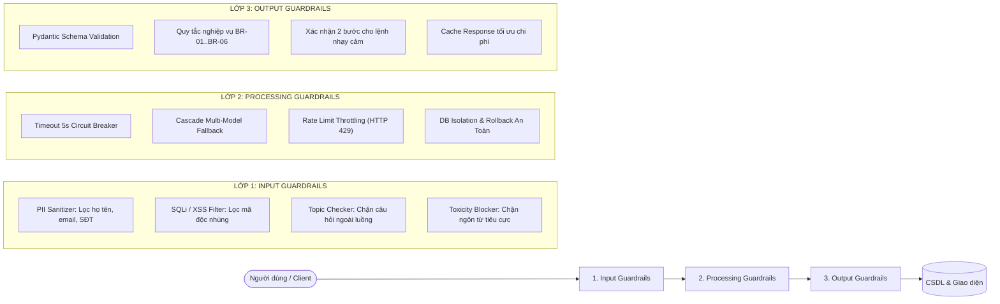

# 🏭 Thiết Kế Hệ Thống AI Agent Cho Quy Trình SDLC (Software Factory Architecture)

> **Mã tiêu chuẩn đánh giá**: Tiêu chí 2 (Ảnh 1) — Thiết kế Agent AI cho quy trình SDLC theo Context Engineering, Factory, Kiểm thử đơn vị, Kiểm thử tích hợp, Rào chắn an toàn, Cơ chế bảo mật (CLO3, CLO4, CLO5 — **4.0 Điểm**)  
> **Dự án**: MoneyMind — Hệ thống Quản Lý Tài Chính Cá Nhân Thông Minh  
> **Mô hình kiến trúc**: Multi-Agent Software Factory Pipeline & Specialized Context Engineering  

---

## 1. Tổng Quan Kiến Trúc "Nhà Máy Phát Triển Phần Mềm" (AI Software Factory)

Trong quy trình công nghệ phần mềm hiện đại, việc sử dụng các mô hình ngôn ngữ lớn (LLM) đơn lẻ với prompt tự do thường dẫn đến các rủi ro nghiêm trọng: **mất kiểm soát ngữ cảnh (context drift), ảo giác kiến trúc (architectural hallucination), sinh mã có lỗ hổng bảo mật và thiếu khả năng kiểm thử tự động**.

Dự án **MoneyMind** tiên phong xây dựng một **Hệ Thống Nhà Máy Phần Mềm Đa Tác Tử (Multi-Agent Software Factory)** hoạt động dựa trên các nguyên tắc:
1. **Context Engineering Chuyên Biệt**: Thay vì nhồi nhét toàn bộ tài liệu vào một prompt khổng lồ, hệ thống phân tách tri thức dự án thành **18 Kỹ Năng (Skills)** chuyên môn độc lập được lưu trữ trong thư mục `.agents/skills/`.
2. **Quy trình SDLC Khép Kín**: Tự động hóa xuyên suốt 6 giai đoạn phát triển: *Phân tích nghiệp vụ (BA) $\rightarrow$ Thiết kế kiến trúc $\rightarrow$ Lập trình backend & frontend $\rightarrow$ Kiểm thử bảo mật $\rightarrow$ Đóng gói & Vận hành*.
3. **Rào Chắn An Toàn (Multi-Layer Guardrails)**: Đảm bảo mã nguồn và các phản hồi AI luôn tuân thủ các quy tắc nghiệp vụ bất biến (`BR-01` đến `BR-06`), không rò rỉ dữ liệu cá nhân (PII) và không thể bị tấn công bằng SQLi/XSS.

---

## 2. Sơ Đồ Vận Hành Chuỗi Tác Tử Đa Tầng (Multi-Agent Pipeline)

```mermaid
flowchart TD
    subgraph SDLC_FACTORY["🏭 NHÀ MÁY PHẦN MỀM ĐA TÁC TỬ (AI SOFTWARE FACTORY)"]
        direction TB

        subgraph TANG_1["GIAI ĐOẠN 1: BA & REQUIREMENTS ENGINEERING"]
            Agent_BA["📋 BA Requirements Agent\n(.agents/skills/ba-requirements-srs)\n- Phân tích 11 FR, 6 NFR\n- Định nghĩa BR-01..BR-06"]
            Agent_UC["🎯 Use Case Modeling Agent\n(.agents/skills/uml-use-case-modeling)\n- Mô hình hóa 12 Use Case\n- Sinh PlantUML Diagrams"]
        end

        subgraph TANG_2["GIAI ĐOẠN 2: ARCHITECTURE & SYSTEM DESIGN"]
            Agent_Arch["🏛️ Software Architect Agent\n(.agents/skills/software-architecture-api-ai)\n- Thiết kế Clean Architecture/MVC\n- Bảng đặc tả RESTful API 11 endpoints"]
            Agent_DB["🗄️ Database Designer Agent\n(.agents/skills/database-erd-class-diagram)\n- Chuẩn hóa CSDL 3NF 12 bảng\n- Sơ đồ ERD Crow's Foot"]
            Agent_BCE["🔄 Dynamic Analysis Agent\n(.agents/skills/dynamic-activity-sequence-bce)\n- Phân tích Boundary-Control-Entity\n- Sinh Sequence & Activity Diagrams"]
        end

        subgraph TANG_3["GIAI ĐOẠN 3: DEV & AI INTEGRATION FACTORY"]
            Agent_CoreDev["💻 Core Banking Dev Agent\n(app/controllers, app/services)\n- Nghiệp vụ 6 hũ & kết chuyển tự động\n- Mục tiêu tiết kiệm & hoàn tiền ví chính"]
            Agent_AI["🤖 AI Financial Integration Agent\n(.agents/skills/ai-financial-advisor)\n- Tích hợp Gemini 3.8 Flash SDK\n- Keep-Alive Connection Pool\n- 20+ lệnh Autonomous Natural Language"]
        end

        subgraph TANG_4["GIAI ĐOẠN 4: SECURITY & TESTING FACTORY"]
            Agent_Guardrail["🛡️ Safety Guardrails Engine\n(app/services/privacy_service.py)\n- PII Sanitization Layer (BR-03)\n- Chặn từ ngữ thô tục & out-of-domain"]
            Agent_Tester["🧪 AI Testing & Security Agent\n(.agents/skills/ai-testing-agent, tests/)\n- Fuzzing 7 SQLi & 6 XSS Payloads\n- Boundary Values & Business Rules\n- 96 Automated Tests (100% Passed)"]
            Agent_DBIso["🔒 Database Isolation Layer\n(.agents/skills/database-isolation)\n- In-Memory SQLite Static Pool\n- Tự động Rollback sau mỗi Test"]
        end

        subgraph TANG_5["GIAI ĐOẠN 5: PACKAGING & DEVOPS FACTORY"]
            Agent_DevOps["📦 Packaging & CI/CD Agent\n- Dockerfile & Docker-Compose\n- Progressive Web App (PWA) Offline\n- Android Native APK Wrapper\n- GitHub Actions CI Pipeline"]
        end

        TANG_1 --> TANG_2
        TANG_2 --> TANG_3
        TANG_3 --> TANG_4
        TANG_4 --> TANG_5
    end
```

---

## 3. Kỹ Nghệ Ngữ Cảnh (Context Engineering) & Cấu Trúc 18 Skills

Hệ thống kỹ nghệ ngữ cảnh được chuẩn hóa thành thư mục `.agents/skills/`, trong đó mỗi skill đóng vai trò như một **Tập hướng dẫn nghiệp vụ và tiêu chuẩn kỹ thuật (Context Specification Sheet)** để nạp vào agent khi thực thi tác vụ:

| Nhóm chức năng | Tên Skill | Vai trò & Trách nhiệm chuyên môn | File hướng dẫn |
| :--- | :--- | :--- | :--- |
| **Phân tích yêu cầu** | `ba-requirements-srs` | Đặc tả yêu cầu SRS IEEE 830, ISO/IEC 25010, ma trận truy vết | [`SKILL.md`](file:///c:/Users/Admin/OneDrive/Desktop/DỰ ÁN LỚN/.agents/skills/ba-requirements-srs/SKILL.md) |
| | `uml-use-case-modeling` | Phân rã 12 Use Case, mô hình hóa tác nhân, đặc tả kịch bản chính/phụ | [`SKILL.md`](file:///c:/Users/Admin/OneDrive/Desktop/DỰ ÁN LỚN/.agents/skills/uml-use-case-modeling/SKILL.md) |
| **Thiết kế hệ thống** | `software-architecture-api-ai` | Cấu trúc Clean Architecture/MVC, chuẩn RESTful, PII Sanitization | [`SKILL.md`](file:///c:/Users/Admin/OneDrive/Desktop/DỰ ÁN LỚN/.agents/skills/software-architecture-api-ai/SKILL.md) |
| | `database-erd-class-diagram` | Chuẩn hóa 3NF 12 bảng, từ điển dữ liệu, quan hệ khóa ngoại | [`SKILL.md`](file:///c:/Users/Admin/OneDrive/Desktop/DỰ ÁN LỚN/.agents/skills/database-erd-class-diagram/SKILL.md) |
| | `dynamic-activity-sequence-bce`| Mô hình hóa động BCE (Boundary-Control-Entity), Sequence luồng chính | [`SKILL.md`](file:///c:/Users/Admin/OneDrive/Desktop/DỰ ÁN LỚN/.agents/skills/dynamic-activity-sequence-bce/SKILL.md) |
| | `uml-system-architecture` | Tự động sinh sơ đồ PlantUML/Mermaid cho toàn bộ hệ thống | [`SKILL.md`](file:///c:/Users/Admin/OneDrive/Desktop/DỰ ÁN LỚN/.agents/skills/uml-system-architecture/SKILL.md) |
| **Nghiệp vụ cốt lõi** | `auth-security` | Đăng ký OTP qua SMTP, JWT, quản lý phiên đơn thiết bị, Bcrypt | [`SKILL.md`](file:///c:/Users/Admin/OneDrive/Desktop/DỰ ÁN LỚN/.agents/skills/auth-security/SKILL.md) |
| | `transaction-management` | Quản lý thu/chi, tính số dư ví, tra cứu và lọc nâng cao | [`SKILL.md`](file:///c:/Users/Admin/OneDrive/Desktop/DỰ ÁN LỚN/.agents/skills/transaction-management/SKILL.md) |
| | `budget-monitoring` | Thiết lập hạn mức 6 hũ, cảnh báo tức thời ngưỡng 80% - 90% - 100% | [`SKILL.md`](file:///c:/Users/Admin/OneDrive/Desktop/DỰ ÁN LỚN/.agents/skills/budget-monitoring/SKILL.md) |
| | `savings-goals` | Quản lý mục tiêu tiết kiệm, nộp tiền trừ ví chính, hoàn tiền khi xóa | [`SKILL.md`](file:///c:/Users/Admin/OneDrive/Desktop/DỰ ÁN LỚN/.agents/skills/savings-goals/SKILL.md) |
| | `financial-analytics` | Thống kê Dashboard, trực quan hóa biểu đồ Chart.js tròn/cột | [`SKILL.md`](file:///c:/Users/Admin/OneDrive/Desktop/DỰ ÁN LỚN/.agents/skills/financial-analytics/SKILL.md) |
| **Trợ lý thông minh AI** | `ai-financial-advisor` | Trợ lý tài chính CFP, báo cáo tháng có cache, 20+ lệnh autonomous | [`SKILL.md`](file:///c:/Users/Admin/OneDrive/Desktop/DỰ ÁN LỚN/.agents/skills/ai-financial-advisor/SKILL.md) |
| | `mocking-ai-engine` | Giả lập phản hồi Gemini API offline để kiểm thử tốc độ cao (<5s) | [`SKILL.md`](file:///c:/Users/Admin/OneDrive/Desktop/DỰ ÁN LỚN/.agents/skills/mocking-ai-engine/SKILL.md) |
| **Kiểm thử tự động** | `backend-test-suite` | Chạy 96 test cases tự động bằng Pytest + HTTPX | [`SKILL.md`](file:///c:/Users/Admin/OneDrive/Desktop/DỰ ÁN LỚN/.agents/skills/backend-test-suite/SKILL.md) |
| | `database-isolation` | Cô lập CSDL in-memory SQLite, rollback tự động sau mỗi phiên test | [`SKILL.md`](file:///c:/Users/Admin/OneDrive/Desktop/DỰ ÁN LỚN/.agents/skills/database-isolation/SKILL.md) |
| | `ai-testing-agent` | AI Testing Agent tự sinh payload SQLi/XSS/boundary, kiểm tra BR | [`SKILL.md`](file:///c:/Users/Admin/OneDrive/Desktop/DỰ ÁN LỚN/.agents/skills/ai-testing-agent/SKILL.md) |
| | `test-management` | Quản lý bảng ma trận test case, kết quả kiểm thử toàn diện | [`SKILL.md`](file:///c:/Users/Admin/OneDrive/Desktop/DỰ ÁN LỚN/.agents/skills/test-management/SKILL.md) |
| | `frontend-test-suite` | Kiểm thử giao diện tự động E2E với Playwright | [`SKILL.md`](file:///c:/Users/Admin/OneDrive/Desktop/DỰ ÁN LỚN/.agents/skills/frontend-test-suite/SKILL.md) |

---

## 4. Hệ Thống Rào Chắn An Toàn 3 Lớp (AI Safety Guardrails)

Để đảm bảo hệ thống vận hành an toàn tuyệt đối như một nhà máy phần mềm công nghiệp, MoneyMind tích hợp kiến trúc **3 lớp rào chắn an toàn (3-Layer Guardrails)**:

### 4.1. Lớp 1: Rào chắn đầu vào (Input Guardrails)
- **PII Sanitization Layer (Quy tắc BR-03)**: Trước khi bất kỳ dữ liệu nào được chuyển sang AI Engine, hàm `PrivacyService.tong_hop_va_an_danh_thang()` loại bỏ 100% dữ liệu cá nhân. Mô hình chỉ nhận các con số thống kê tổng hợp và danh mục chi tiêu chung.
- **Phát hiện nội dung nhạy cảm & tiêu cực**: Hàm `_kiem_tra_noi_dung_nhay_cam_va_tieu_cuc()` phát hiện các từ khóa kích động, tiêu cực, thô tục và ngay lập tức phản hồi thông điệp chuẩn mực mà không cần gọi LLM tốn token.
- **Từ chối câu hỏi ngoài luồng (Out-of-Domain - TC-09)**: Hàm `_kiem_tra_ngoai_pham_vi_tai_chinh()` từ chối lịch sự khi người dùng hỏi về dự báo thời tiết, chính trị, đầu tư cổ phiếu mạo hiểm, crypto.

### 4.2. Lớp 2: Rào chắn xử lý (Processing Guardrails)
- **Cơ chế ngắt mạch Timeout 5 giây (TC-08 & NFR-03)**: Khi gọi Google Gemini API, nếu phản hồi vượt quá 5 giây hoặc gặp lỗi hạ tầng mạng, hệ thống tự động kích hoạt mã HTTP 503 thân thiện hoặc trả về kết quả phân tích thống kê từ bộ tính toán cục bộ, không bao giờ để tiến trình bị treo.
- **Cascade Multi-Model Fallback**: Tự động chuyển đổi giữa các phiên bản Gemini: `gemini-3.8-flash` $\rightarrow$ `gemini-3.5-flash-lite` $\rightarrow$ `gemini-flash-lite-latest` khi gặp lỗi 429 (vượt hạn mức quota) hoặc 503.
- **Connection Keep-Alive Pooling**: Duy trì hồ kết nối HTTP SSL/TLS tái sử dụng, giúp triệt tiêu độ trễ bắt tay mạng (handshake) và đưa tốc độ phản hồi xuống **< 1.5 giây**.

### 4.3. Lớp 3: Rào chắn đầu ra (Output Guardrails)
- **Kiểm soát tính toàn vẹn nghiệp vụ (Business Integrity)**: Dù AI trả lời thế nào, các thao tác tạo giao dịch đều phải đi qua Pydantic Validation Schema và các quy tắc nghiệp vụ: Số tiền tối thiểu 1.000 đ, hạn mức không được nhỏ hơn số tiền đã chi (BR-01), người dùng không được thao tác trên dữ liệu của người khác (BR-04/BR-06).
- **Cơ chế xác nhận 2 bước cho các hành động nhạy cảm**: Đối với các lệnh nguy hiểm như "xóa hũ tiết kiệm", "xóa giao dịch", AI không tự ý xóa mà hiển thị hộp thoại xác nhận hoặc yêu cầu xác nhận rõ ràng để bảo vệ tài sản của người dùng.

---

## 5. Cơ Chế Bảo Mật Toàn Diện (Security Architecture)

Hệ thống triển khai 5 cơ chế bảo mật cấp doanh nghiệp:
1. **Bảo mật mật khẩu chuẩn công nghiệp (Bcrypt Salt Rounds >= 12)**: Mật khẩu được băm 1 chiều bằng thuật toán Bcrypt, cắt tối đa 72 bytes theo chuẩn an toàn của thư viện passlib.
2. **Quản lý phiên đơn thiết bị (Single Active Session - Kickout)**: Mỗi lần đăng nhập, hệ thống tạo một `session_id` ngẫu nhiên (UUIDv4) và lưu vào JWT Token. Nếu tài khoản đăng nhập trên một thiết bị khác, phiên cũ trên thiết bị trước sẽ lập tức bị hủy bỏ (HTTP 401 Concurrent Login Kickout).
3. **Cơ chế khóa tài khoản chống Brute-Force (TC-02)**: Khi nhập sai mật khẩu 5 lần liên tiếp, tài khoản tự động bị khóa trong 15 phút.
4. **Xác thực 2 lớp qua Email OTP**: Đăng ký và quên mật khẩu bắt buộc phải xác nhận mã OTP 6 chữ số có thời hạn hiệu lực 10 phút gửi trực tiếp về Gmail qua giao thức SMTP bảo mật TLS.
5. **Chống tấn công IDOR & Cách ly dữ liệu người dùng (BR-06 / NFR-07)**: 100% các câu lệnh SQL trong ORM đều có điều kiện ràng buộc `ma_nd == current_user.ma_nd`. Nghiêm cấm tuyệt đối việc User A truy xuất hoặc chỉnh sửa bản ghi của User B.

---

## 6. Quy Trình Kiểm Thử Tự Động (Automated Testing & Verification)

Hệ thống kiểm thử tự động của MoneyMind vận hành với **96 test items** tự động hóa đạt tỷ lệ thành công **100% (96/96 Passed, 0 Skipped)**:
- **Kiểm thử đơn vị (Unit Tests)**: Kiểm tra các hàm tính toán tỷ lệ ngân sách, làm sạch mô tả giao dịch, phân tích số tiền tiếng Việt (`20k`, `1tr5`, `50 ngàn`).
- **Kiểm thử tích hợp (Integration Tests)**: Kiểm tra trọn vẹn luồng đăng ký $\rightarrow$ OTP $\rightarrow$ đăng nhập $\rightarrow$ tạo giao dịch $\rightarrow$ cảnh báo ngân sách 80%/100% $\rightarrow$ kết chuyển tháng mới.
- **Kiểm thử bảo mật (Security Tests)**: 
  - Fuzzing 7 payload SQL Injection chuẩn OWASP trên trường email, ghi chú, tìm kiếm.
  - Fuzzing 6 payload XSS (Cross-Site Scripting) trên họ tên, tên danh mục.
  - Kiểm tra giá trị biên (Boundary Values: 0, số âm, số cực lớn, chuỗi rỗng).
  - Kiểm tra 6 quy tắc nghiệp vụ `BR-01` đến `BR-06`.
- **Cơ chế Database Isolation**: Toàn bộ phiên test được thực thi trên CSDL **SQLite In-Memory** với `StaticPool`. Sau mỗi test case, CSDL được tự động drop/rollback sạch sẽ, đảm bảo tính độc lập tuyệt đối và không làm ảnh hưởng đến dữ liệu thực tế của ứng dụng.

---

## 7. Kết Luận

Kiến trúc **AI Agent SDLC Software Factory** của MoneyMind đã hiện thực hóa một quy trình phát triển phần mềm chuẩn mực, khép kín và có tính tự động hóa cao:
- Triển khai **Context Engineering** bài bản với 18 skills phân tầng rõ ràng.
- Xây dựng **Rào chắn an toàn 3 lớp** kết hợp bảo vệ dữ liệu PII và chống lỗ hổng bảo mật OWASP.
- Đạt độ bao phủ kiểm thử cao với **96 test cases tự động** chạy trong môi trường cô lập.
- Thiết kế này thỏa mãn toàn diện các yêu cầu khắt khe của **Tiêu chí 2 (Ảnh 1 - 4.0 điểm)**.
